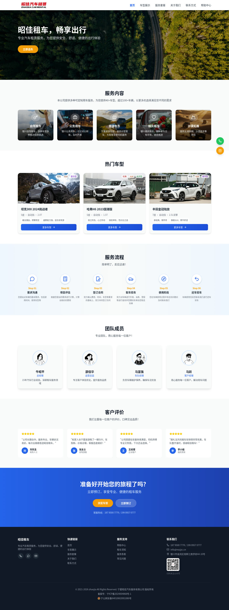
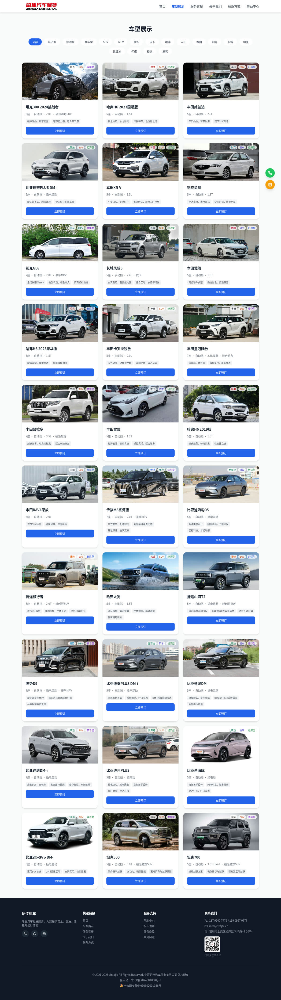
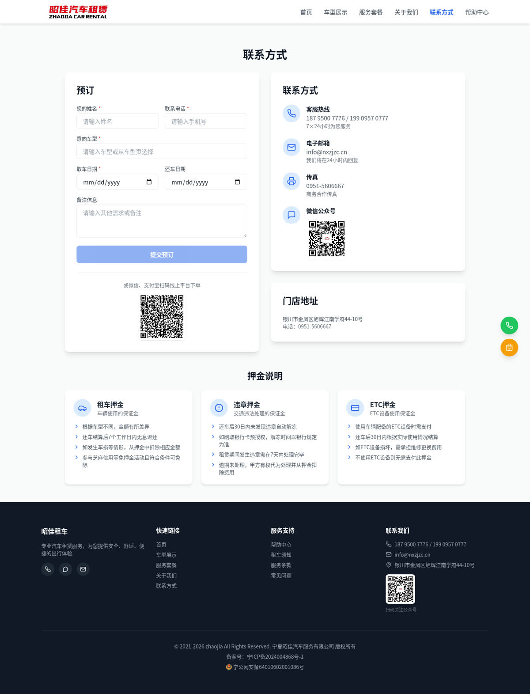
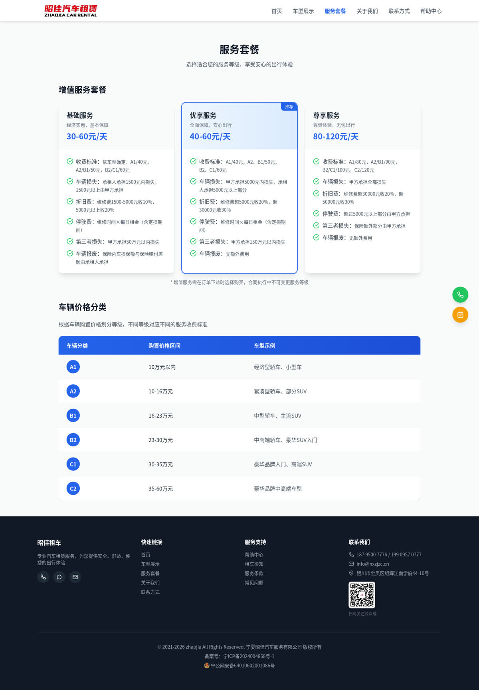
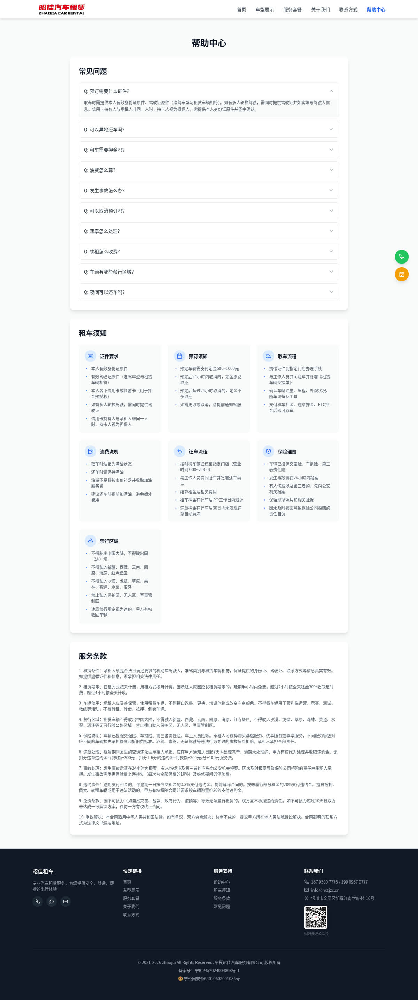
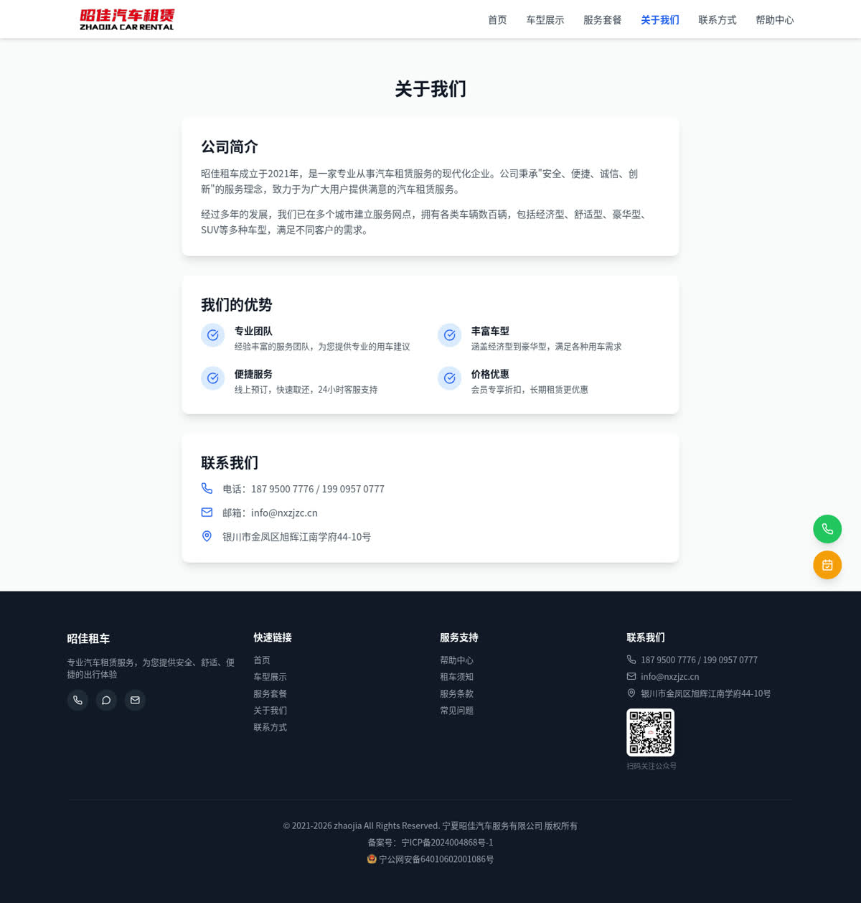

# 昭佳租车官网（Vue 3 版）

宁夏昭佳汽车服务有限公司官方网站，提供银川租车、宁夏租车、自驾租车、公务租车、旅游包车、婚庆租车等服务。

项目已从 **Alpine.js + CDN Tailwind** 的单文件写法重构为 **Vue 3 + Vite** 组件化工程，页面结构、视觉样式、数据结构、预订流程与原版保持一致。

## 页面预览

| 首页 | 车型展示 |
| --- | --- |
|  |  |

| 联系方式 / 预订 | 服务套餐 |
| --- | --- |
|  |  |

| 帮助中心 | 关于我们 |
| --- | --- |
|  |  |

移动端：

## 技术栈

| 能力 | 方案 |
| --- | --- |
| 前端框架 | Vue 3（`<script setup>` 组合式 API） |
| 构建工具 | Vite 6 |
| 路由 | Vue Router 4（hash 模式） |
| 样式 | Tailwind CSS 3（本地编译，不再依赖 CDN） |
| 图标 | Lucide（`lucide-vue-next`，按需引入） |
| 数据 | `src/data/carRentalData.js`（ESM 模块） |

## 目录结构

```
zjzc/
├── index.html                  # Vite 入口（SEO / 统计 / 备案 meta 全部保留）
├── vite.config.js
├── tailwind.config.js          # 主题色 primary / secondary / accent
├── postcss.config.js
├── scripts/copy-assets.mjs     # 构建后把 images/ 复制进 dist/
├── src/
│   ├── main.js
│   ├── App.vue                 # 布局：导航 + <RouterView> + 页脚 + 悬浮按钮
│   ├── style.css               # Tailwind 指令 + 少量全局样式
│   ├── router/index.js         # 路由与页面标题
│   ├── data/
│   │   ├── carRentalData.js    # 全站数据（车型、套餐、FAQ、公司信息…）
│   │   ├── assets.js           # assetUrl()：图片路径解析（本地 / CDN 可切换）
│   │   └── helpers.js          # 分类名称/颜色、车型筛选、手机号校验
│   ├── stores/booking.js       # 预订表单共享状态（车型页 -> 联系页联动）
│   ├── services/bookingService.js  # 钉钉 webhook 提交（经 Cloudflare Worker 代理）
│   ├── composables/useScrollY.js   # 共享滚动位置、返回顶部
│   ├── components/
│   │   ├── AppNavbar.vue / AppFooter.vue / FloatingActions.vue
│   │   ├── AppIcon.vue + icons.js  # Lucide 图标白名单
│   │   ├── VehicleCard.vue         # 车型卡片（首页 / 车型页复用）
│   │   ├── BookingForm.vue         # 预订表单（校验 + 提交反馈）
│   │   ├── ContactInfoList.vue / StoreList.vue / FaqAccordion.vue
│   └── views/
│       ├── HomeView.vue        # 首页
│       ├── VehiclesView.vue    # 车型展示
│       ├── PackagesView.vue    # 服务套餐
│       ├── AboutView.vue       # 关于我们
│       ├── ContactView.vue     # 联系方式 + 在线预订
│       └── HelpView.vue        # 帮助中心
├── images/                     # 图片资源（构建时复制到 dist/images）
├── cloudflare-worker.js        # 钉钉 Webhook 代理（Cloudflare Worker）
├── legacy/                     # 重构前的 Alpine.js 版本备份
└── 协会合同.docx
```

## 快速开始

```bash
npm install      # 安装依赖
npm run dev      # 开发模式 http://localhost:5173
npm run build    # 生产构建，输出 dist/
npm run preview  # 预览构建产物
```

要求 Node.js ≥ 18。

## 路由

站点为纯前端 SPA，使用 hash 路由，静态托管无需任何 rewrite 配置：

| 页面 | 地址 |
| --- | --- |
| 首页 | `/#/` |
| 车型展示 | `/#/vehicles` |
| 服务套餐 | `/#/packages` |
| 关于我们 | `/#/about` |
| 联系方式 / 预订 | `/#/contact` |
| 帮助中心 | `/#/help` |

> 如需切换为无 `#` 的 history 模式：把 `src/router/index.js` 中的 `createWebHashHistory` 换成
> `createWebHistory`，并在托管平台配置 SPA 回退（Nginx `try_files`、Cloudflare Pages 的
> `_redirects`）后再上线。

## 数据配置

### 添加新车型

编辑 `src/data/carRentalData.js` 的 `vehicles` 数组：

```javascript
{
  id: 31,
  name: "车型名称",
  categories: ["品牌", "车型类型", "价格档次"],  // 对应 categories 里的 id
  image: assetUrl("图片文件名.jpg"),              // 或直接写 https:// 完整地址
  specs: "座位数 · 变速箱 · 排量/动力",
  features: ["特点1", "特点2"]
}
```

图片放在根目录 `images/`，构建时会自动进入 `dist/images/`。

### 添加新品牌分类

1. 在 `categories` 数组里加一条 `{ id, name, color }`；
2. 在 `src/data/helpers.js` 的 `categoryColorMap` 里补上对应文字颜色（Tailwind class）。

### 首页热门车型

`hotVehicles: [1, 2, 12]` 填写车型 `id` 即可。

## 环境变量（可选）

复制 `.env.example` 为 `.env.local` 后按需修改：

| 变量 | 说明 |
| --- | --- |
| `VITE_IMAGE_BASE` | 图片基础地址。默认使用站点同源 `images/`；国内访问可改为 CDN，例如 `https://cdn.jsdmirror.com/gh/gitmfq/zjzc@master/images/` |
| `VITE_WEBHOOK_ENDPOINT` | 预订消息推送地址，默认 `https://webhook.osai.eu.org`（Cloudflare Worker 代理，见 `cloudflare-worker.js`） |

## 部署

构建产物 `dist/` 为完整可部署站点（含 `images/`），上传即可：

- **Cloudflare Pages / Netlify / Vercel**：构建命令 `npm run build`，输出目录 `dist`
- **GitHub Pages（Actions）**：

  ```yaml
  name: deploy
  on:
    push:
      branches: [master]
  permissions:
    contents: read
    pages: write
    id-token: write
  jobs:
    build:
      runs-on: ubuntu-latest
      steps:
        - uses: actions/checkout@v4
        - uses: actions/setup-node@v4
          with:
            node-version: 20
        - run: npm ci
        - run: npm run build
        - uses: actions/upload-pages-artifact@v3
          with:
            path: dist
    deploy:
      needs: build
      runs-on: ubuntu-latest
      environment: github-pages
      steps:
        - uses: actions/deploy-pages@v4
  ```

- **任意静态服务器**：把 `dist/` 内容放到站点根目录（如 Nginx `root`）

> 站点使用相对路径（`base: './'`），部署到二级目录（如 `https://example.com/zjzc/`）也能正常工作。

## 重构说明

- 原有 Alpine 模板全部拆分为 Vue 单文件组件，模板拼接字符串（`Templates.xxx()`）改为声明式渲染；
- 运行时不再依赖 `cdn.tailwindcss.com`、Alpine CDN、`unpkg`，构建后样式与脚本均本地化，首屏更快、离线可用；
- 图标由运行时 `lucide.createIcons()` 改为组件化按需引入；
- 预订表单的「车型联动」由自定义事件改为共享状态模块；
- 旧版本完整保留在 `legacy/`（`index.alpine.html`、`main.js`、`data.js`、`style.css`、`tank.html` 等），便于对照与回退，说明见 `legacy/README.md`。

## 相关链接

- 官网: https://www.nxzjzc.cn
- 备案号: 宁ICP备2024004868号-1
- 公安备案: 宁公网安备64010602001086号

## 联系方式

- 电话: 187 9500 7776 / 199 0957 0777
- 邮箱: info@nxzjzc.cn
- 地址: 银川市金凤区旭辉江南学府44-10号

## License

Copyright © 2024 宁夏昭佳汽车服务有限公司
